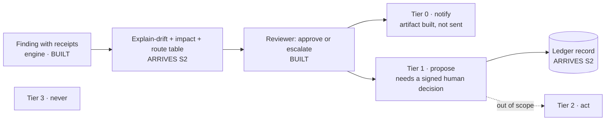

# Governance model — who decides, who recommends, who signs

**Type:** explanation + reference (Diátaxis) · **Audience:** a platform's risk, operations and compliance readers · **Status:** written 2026-10-12, Wave 1 / S4-docs · **Source of the contracts below:** `docs/plan-menu-integrity-crew-2026-10-09.md` §§ 5, 6, 17 as amended by `docs/plan-wave2-gap-sheet-2026-10-12.md` (pages 1–3) and the 2026-10-12 entries in `docs/decision-log.md`. `RULES.md` wins over this file.

## The answer first

Curbside Commons is a **human-gated, sequential workflow** that checks a delivery platform's copy of a merchant's menu against the merchant's own record. Three rules carry the whole governance model:

1. **The engine decides.** Verdicts come from versioned rule tables: byte-reproducible, no clock, no model, no network.
2. **Agents recommend.** AI "seats" triage and explain in a separate envelope. They cannot flip a verdict, and every one carries a label earned per model, or the word DEFER.
3. **Humans approve.** Anything that would act needs a signed human decision. In the pilot the product **proposes at most; it never acts** (Tier 1, below).

*In plain words:* a calculator does the judging, a rule table decides who should look at a finding, an AI assistant is only allowed to say "approve this routing" or "hand it to a person", and a named person signs before anything happens. The AI cannot overrule the calculator, and the pilot stops before anything is changed.

**Decoder (first use).** *Verdict* — the engine's pass or fail on one comparison, with evidence. *Receipt* — the evidence attached to a finding: the claim, the reference row, the rule id, the severity. *Seat* — one role in the crew (some are deterministic code, some are model-driven). *Drift* — the platform's copy of a menu no longer matching the merchant's record. *DEFER* — the honest label for "this has not passed its exam on this model". Terms of art are also in [`GLOSSARY.md`](GLOSSARY.md).

## What this document is not claiming

- **Everything this project runs on is synthetic.** The merchants, menus, orders and fee statements are invented and labeled as such. This project never holds, receives or renders real platform data (decision D-7(a), 2026-10-12).
- **Platform-shaped inputs are "shaped like the public integration docs, not from the platform."** Platform names in this kit are nominative references to public documentation. No logo is used, and no endorsement, affiliation, partnership, access or real-world impact is claimed or implied. No figure in this file is a measurement of any platform.
- **Human-led, AI-assisted, professionally reviewed** (`RULES.md` §4). This is a prototype that runs on demand, not an operated service.
- **Certification:** no certification or audit attestation is held or claimed. **ISO/IEC 42001 is NOT claimed** (see § 9). The NIST crosswalk is a mapping for discussion, not a conformance statement.
- **The legal pack covers one law only:** NYC Administrative Code §20-563.3. It is not legal advice, and it computes no penalties. United States only throughout (`docs/plan-menu-integrity-crew-2026-10-09.md` § 2).

## Status legend (used in every table below)

| Mark | Meaning |
| --- | --- |
| **BUILT** | Exists on `main` at `fac8204`, with a test in the repo. |
| **ARRIVES S\<n\>** | Planned for slice *n* (plan § 12 and the gap sheet). Not on the site or CLI today. |
| **OWED** | Named in plan § 6 as to-add, with no slice assigned. |

Nothing marked ARRIVES or OWED is a capability today. Read those rows as the roadmap and nothing more.

## 1 · Decision rights

| Who | Does what | How it is bounded | Status |
| --- | --- | --- | --- |
| **The engine** | Decides verdicts | Versioned rule tables; byte-reproducible; no clock, no model, no network (an import-graph test fails the build if that changes) | BUILT |
| **A deterministic route table** | Decides which team a finding goes to and which artifacts are built | A rule table (trigger kind · finding categories · max severity · pack → merchant-ops, partner or compliance); readable, changed through change control, tested | ARRIVES S2 (`lib/crew/route.ts`; gap sheet page 1) |
| **Agents (LLM seats)** | Recommend only | Separate envelope; cannot flip a verdict; schema-constrained; label earned **per (seat, model)** on pre-registered floors; DEFER when unproven | BUILT for intake and reviewer · ARRIVES S2 for the root-cause seat, which renders DEFER until it passes an exam |
| **Humans** | Approve, or refuse, anything that would act | Ed25519-signed; bound to the role, to the content and to the run digest; replay- and expiry-checked (seven ordered checks) | BUILT as an offline simulator (`lib/approvals/`); a console surface for it is not on the site today |
| **The platform** | Governs changes to the rules | Change control: the drift-lock fails the build when code and rulebook disagree; a dated freshness check and a named approver are to be added | Drift-lock BUILT for the fee rule table (`evals/packs/fees-drift-lock.test.ts`) · freshness check and named approver OWED |

**Why routing is a rule table and not a model decision.** The reviewer seat earned its label on one narrow surface: approve or escalate (`docs/crew-live-l1-status.md`). Routing is a different decision, and wearing the old label on it would overstate what was measured. A rule table is also what an operations lead can read and audit. The reviewer sees the computed route and may only approve or escalate it. Any escalation, any injection anomaly and any Tier-2 or Tier-3 request goes to `human-escalation` regardless of the table.

## 2 · The crew — roster and labels

The roster follows plan § 5, **amended 2026-10-12** in two places by the gap sheet (marked *amended*). The "Label regime" column is what each seat is allowed to be called on its face.

| Seat | Kind | Reads | Produces | Label regime |
| --- | --- | --- | --- | --- |
| Intake | LLM (exists; floors cleared 2026-07-07) | the trigger + scenario brief | which tool to run, scoped | agent (live-run floors cleared) · DEFER on an un-examined model |
| Audit | deterministic (exists) | feed · record · map | the verifier report | deterministic workflow |
| Evidence | deterministic (exists) | the report | receipts bundle, report hash | deterministic workflow |
| **Explain-drift** *(amended)* | deterministic (NEW, S2) | findings + a scenario event log (who changed what, when) | a timestamp-and-actor explanation of why a finding exists | deterministic workflow; **this is what the pilot shows under "why"** |
| **Root-cause** *(amended)* | LLM (NEW, S2) | findings + the event log, pre-summarised deterministically (findings and events only, no raw text) | one of {sync-latency, merchant-edit, integrator-bug, platform-override, encoding, unknown} + a cited reason | advisory; **renders DEFER on its face until it has sat a pre-registered exam** (floors in the register) · never gates |
| **Impact** | deterministic (NEW, S2) | findings + scenario order velocity | orders at risk · refund $ · error-charge exposure · agent-cancel exposure, with the arithmetic | labeled simulated; every number derived |
| **Route** *(amended)* | deterministic (NEW, S2) | trigger kind · finding categories · max severity · pack | merchant-ops, partner or compliance, plus the artifact set | deterministic workflow |
| Reviewer *(amended)* | LLM (exists; floors cleared) | all of the above, including the computed route | approve or escalate that route | agent (live-run floors cleared), on approve and escalate only |
| Approval | human, signed (exists as simulator) | a proposal bound to the run digest | a signed decision or a refusal | the only path to "executed = recorded" |

**Honest label for the whole.** In the vocabulary of the major model vendors' published agent-design guidance (plan § 16), the crew is a **sequential workflow with bounded LLM seats**, not an autonomous agent. The engine and the rule tables do the judging and the routing. That is the label it carries.

**Where the per-model exam state lives:** [`model-risk-register.md`](model-risk-register.md). A seat's label is per (seat, model); the register is the table that says which pairs have sat their exam.

## 3 · Action tiers

The catalog a risk team asks for. **The pilot stops at Tier 1.**

| Tier | Name | What it covers | Status in this prototype |
| --- | --- | --- | --- |
| **0** | notify | Slack / email / partner-ticket artifacts. A transport, if ever wired, is per-channel, allow-listed, owner-armed. | Slack and email builders BUILT, **not sent**; the partner-ticket builder ARRIVES S4 |
| **1** | propose | 86 an item · force re-sync · hold an item on the agent surface · open a partner ticket. Proposed with receipts and impact; requires a signed human decision; "executed" = a ledger record. | Signed-approval simulator BUILT; the ledger that records "executed" ARRIVES S2 |
| **2** | act on a completed, human-approved audit | e.g. calling a platform API to 86 an item. Permitted in principle by `docs/decisions/crew-acts-2026-07-26.md`; **out of scope here**; never from inside an audit. | Not built, not planned for the pilot |
| **3** | never | Amend a merchant record · issue a credit · file a dispute or complaint on anyone's behalf. | Prohibited |

*In plain words:* Tier 0 is "tell someone", Tier 1 is "suggest an action and write down that a person approved it", Tier 2 is "do it, after a person approved a finished audit", Tier 3 is "we will not do this at all".

## 4 · Control register

Each row: what exists today, what the plan adds.

| Control | Exists today (BUILT) | To add | Status of the addition |
| --- | --- | --- | --- |
| **Evidence** | Claim · reference row · rule id · severity on every finding, enforced by construction | The id-mapping sheet cited as a reference row when it resolves an identity | ARRIVES S3 |
| **Model risk** | Per-seat model pin · a pre-call budget guard (a fail-closed estimate; see below) · injection tripwire before any model turn (`lib/crew/injection-scan.ts`) · report-hash pin when a model touched the run · eval-locks | [`model-risk-register.md`](model-risk-register.md) and a re-exam rule on any model change · a post-call overflow stop · a provider canary | Register and re-exam rule written; exams fill it in S5 · post-call stop ARRIVES S2 (budget truth) · canary ARRIVES S5 |
| **Data** | Nothing leaves the tab or machine in site mode, proven by import-graph tests | A data-classification sheet · an ingest rule that drops any customer field from a platform export, with a planted-field test · a retention rule · a one-page data-handling statement | Classification, retention and handling statement written in `pilot-kit/data-request-spec.md` and `pilot-kit/security-one-pager.md`; the ingest rule (allow-list, drop by default) and its test ARRIVE S3 |
| **Audit trail** | Report hash and the receipts bundle | The run ledger: inputs hashed · rule versions · model versions · recommendations · signer · timestamp, exportable as JSON-lines, hash-chained | ARRIVES S2 |
| **Operational** | Manual trigger only; no scheduler; no standing process | An incident and rollback note · an escalation path · a RACI across merchant-ops, integrations and compliance | Written in §§ 5–7 below |

**An honest limit on the budget guard.** The live path's cap is a **pre-call estimate**. It reserves a conservative cost before each call and refuses the call if the reservation would breach the cap. The paired **post-call overflow stop**, which halts a run when a call bills above its reservation, exists only in the archived legacy orchestrator; **no active driver is wired to the guard today**, and the post-call stop must be re-implemented before any live arming (header of `lib/agents/budget.ts`). Under the 2026-10-12 free-only gate the product runs on free tiers and free local models, so the guard is a fail-safe and not a spend allowance. Free tiers have their own rate ceilings; those are recorded in the register.

## 5 · Who is responsible for what (RACI — a template)

**R** responsible (does it) · **A** accountable (one person, signs) · **C** consulted · **I** informed. Role names follow plan § 17's personas. **The platform assigns the names at pilot start; this table is a proposal, not an existing arrangement.**

| Activity | Merchant-Ops analyst | Integrations manager | Agentic-Commerce PM / engineer | Compliance / Legal analyst |
| --- | --- | --- | --- | --- |
| Run a sweep or a trigger | R | C | I | I |
| Triage a finding | R/A | C | I | I |
| Sign a Tier-1 proposal | **A** | C | C | I |
| Open a partner ticket | C | R/A | I | I |
| Withdraw a proposal (signed counter-decision) | R/A | C | I | C |
| Change a rule table (including the route table) | C | C | C | **A** |
| Change or add a model | I | I | R/A | C |
| Review the exportable ledger | I | I | I | R/A |
| Declare an incident | R | C | C | A |

## 6 · Rule change control

- **What binds today:** for the fee rule table, a drift-lock test fails the build when the code and the codified rulebook disagree. Changing a rule therefore means changing both, visibly, in one reviewed commit.
- **To add (OWED):** a dated freshness check for each rule source, and a named approver on the platform side. The RACI proposes compliance as the approver for rule tables, the route table included.
- **Legal pack scope:** NYC §20-563.3 only. SF's permanent 15 % cap is a registered follow-on, not in the plan.

## 7 · Incident, rollback and escalation

- **A wrong recommendation is withdrawn by a signed counter-decision, never edited.** The record keeps both, in order. *Status: a counter-decision path is not in `lib/approvals/` as far as this lane found, and the plan assigns it to no slice: OWED.*
- **Escalation, always to a human, with the reason stated** (plan § 17, step 7): an injection tripwire fires, an identity is ambiguous, or a Tier-2 or Tier-3 request is made. There are no silent drops. *The tripwire is BUILT; the routing of the other two arrives with the route table (S2).*
- **Unanswered requests close honestly:** the signed-approval flow's expiry check refuses an expired request instead of treating silence as consent. BUILT in the simulator.
- **Rollback of a model or prompt change:** restore the previous model id in the register row and keep the earlier exam record beside it. A model change is never a silent edit (the register's re-exam rule).

## 8 · Pilot governance

The pilot kit in [`pilot-kit/`](pilot-kit/README.md) carries the working documents: a scope document, pre-registered success metrics, a data-request spec, a security one-pager, a ten-minute walkthrough script, and a weekly readout. The shape (plan § 6, as amended by D-7(a′)): **six weeks on the labeled scenario library** (replay by default; owner-armed live model turns on synthetic data only). **Running the tool on a platform's own data is a separate future decision**, with its own data boundary and security assessment, and is not part of this pilot. This project never holds, receives or renders real platform data. Exit criteria for "expand" and for "stop" are fixed before the first run. Honesty is carried into the room: synthetic data is labeled, platform-shaped inputs say "shaped like the public integration docs, not from the platform", and no affiliation is claimed.

**Legal frame (United States only).** The relevant frames are consumer-privacy law where the platform is based (state law; which statute applies is the platform counsel's call, UNVERIFIED here), the FTC, and NYC's Department of Consumer and Worker Protection (DCWP). The FTC's food-delivery-fee rulemaking stood at an advance notice (2026-04-16; comments closed 2026-05-18) with no proposed rule as of 2026-10-09 (plan § 3; federalregister.gov and ftc.gov). The ledger is the kind of recordkeeping the NYC fee-cap docket and the FTC inquiry point toward; that is a direction, not a compliance claim.

## 9 · Crosswalk to the NIST AI RMF (a mapping, not a conformance claim)

**Source.** NIST AI Risk Management Framework: [nist.gov/itl/ai-risk-management-framework](https://www.nist.gov/itl/ai-risk-management-framework), fetched 2026-10-12. The page describes AI RMF 1.0 (released 2023-01-26, voluntary use), the Generative AI Profile (NIST AI 600-1, 2024-07-26), and states that **AI RMF 1.0 is being revised** as part of the White House AI Action Plan. If the revision changes the functions, this table is re-checked. Subcategory identifiers are not cited here.

| RMF function (plain gloss) | Where this project carries it | Status |
| --- | --- | --- |
| **GOVERN** (who is accountable, under what policy) | Decision rights (§ 1) · action tiers (§ 3) · RACI (§ 5) · rule change control (§ 6) · honesty rules in `RULES.md` §4 · the C10 gate that scans every public sentence | Written and tested where marked BUILT; RACI is a template |
| **MAP** (what the system is for, and what can go wrong) | Use case and personas (plan § 17) · scenario library of eight drift stories (plan § 9) · data-classification sheet · the "what we are not claiming" boxes | Written; scenarios ARRIVE S1–S4 |
| **MEASURE** (evidence the system works, per model) | Pre-registered floors, eval-locks and burned splits · the model-risk register (label per seat and model) · derived-figures rule (no typed number) · deterministic baselines the model seats must beat | BUILT for intake, reviewer and the fee classifier; root-cause exam ARRIVES S5 |
| **MANAGE** (acting on risk, and recovering) | Tiers 0–3 · signed approval · DEFER on an un-examined model · escalation to a human · counter-decision, never edit · injection tripwire · the ledger | Mixed; each row marks BUILT, ARRIVES or OWED |

**ISO/IEC 42001 is NOT claimed.** This project holds no management-system certification, has not been assessed against that standard, and does not claim alignment with it. A platform that needs 42001 evidence would be asking for an organisational management system, which a prototype run by one owner does not have.

## Sources and dates

- Plan of record: `docs/plan-menu-integrity-crew-2026-10-09.md` §§ 2, 3, 5, 6, 16, 17 (2026-10-09); `docs/plan-wave2-gap-sheet-2026-10-12.md` pages 1–3 (2026-10-12); `docs/decision-log.md` 2026-10-12 (D-7(a), free-only gate).
- Crew-acts decision: `docs/decisions/crew-acts-2026-07-26.md`.
- Seat exam records: `docs/crew-live-l1-status.md` (intake and reviewer).
- NIST: link above, fetched 2026-10-12.
- Honesty rules: `RULES.md` §§ 4, 6, 8. The C10 gate (`evals/packs/honesty-c10.test.ts`) scans this file for affirmative overclaims.
